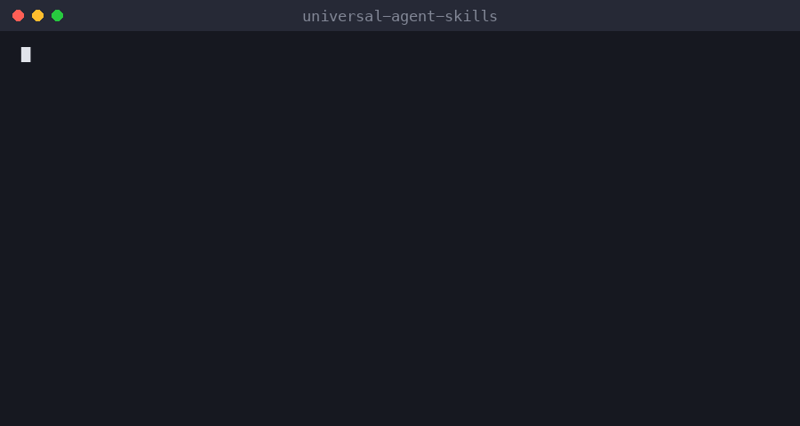

# universal-agent-skills

Reusable skills that work in **Claude Code**, **OpenAI Codex** and **GitHub Copilot**.

> **Stop AI agents from rewriting your whole codebase.** Plan first, test first, change only what's needed.



*Illustrative demo of the workflow.*

## How it works

```
plan-first-tdd-change
  branch from main → deep plan → YOU approve assumptions
  → failing tests → smallest code change → diff audit

feature-delivery-team
  PM → architect → 3 devs (parallel) → 2 QA → fix loop → final report
```

## Skills

| Skill | What it does |
|---|---|
| [plan-first-tdd-change](skills/plan-first-tdd-change) | Branch from main → deep plan → you approve assumptions → failing tests → smallest possible code change |
| [feature-delivery-team](skills/feature-delivery-team) | A PM agent runs an architect, 3 devs and 2 QA as subagents to deliver one feature end to end, with minimal token use |
| [WordPress bundle](bundles/wordpress-website) | 6 `wp-*` skills: build a complete responsive, animated, accessible WordPress site (`wp-build-complete-website` + 5 helpers) |


## Install

Run from your project root (or use the global folder to install for all projects):

```bash
git clone https://github.com/subhannaeem/universal-agent-skills.git
cd universal-agent-skills && ./install.sh
```

`./install.sh wordpress` installs only the WordPress bundle. `install.sh` copies every skill to `.claude/skills`, `.agents/skills` and `.github/skills` in the current project. Run `./install.sh --global` to install to `~/.claude/skills`, `~/.codex/skills` and `~/.copilot/skills` instead.

## Use

Ask your agent:

> Use plan-first-tdd-change to add *<your feature or fix>* on branch *<branch-name>*.
>
> Use feature-delivery-team to build *<feature description>*.

It will stop and wait for you to approve its assumptions before writing any code.

## Support

If this helps you, give it a ⭐ and share it. Issues and PRs welcome.

## License

MIT © Muhammad Subhan
